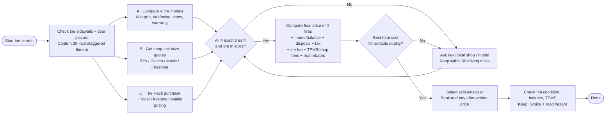

# Find the BEST tire installed for the LOWEST all-in local price

**Hard rule:** installation no more than **50 driving miles** from home in Jersey City Heights. Stop researching once a clear winner is documented; avoid unrelated car ownership, dealer disputes or legal work.

## Action order

| When | Who / what | Required result |
|---|---|---|
| **1 · prerequisite** | Inspect current front/rear sidewalls and door label, verify whether run-flat/OE constraints apply | Correct sizes, minimum load/speed, confirmed 4MATIC suitability |
| **2 · parallel A** | Compare Falken FK460, Vredestein Hypertrac, Continental DWS 06 Plus, Michelin Pilot Sport AS4 | Clear quality/value shortlist |
| **2 · parallel B** | Get fully itemized local shop tire+install prices at BJ's Jersey City, Costco Bayonne, Mavis North Bergen | Same exact tire model + two sizes; complete NJ out-the-door total |
| **2 · parallel C** | Compare online Tire Rack to Tire Rack-listed Firestone Jersey City installation | Written cart total after all shop and tax/fees |
| **3 · sequential** | Compare offers in [quotes.csv](../data/quotes.csv) | Lowest suitable *actual* price, confirmed local stock, 50-mile route |
| **4 · sequential** | Book winner and inspect work | Installation receipt, rims protected, proper balancing/TPMS |

## The only questions to ask each shop

> I have a 2024 Mercedes CLE 300 4MATIC Cabriolet on 20-inch staggered AMG wheels. Preliminary sizes are 245/35ZR20 95Y XL **front ×2** and 275/30ZR20 97Y XL **rear ×2**, which I will confirm on the sidewalls. Please quote **four matching all-season tires** in Continental DWS 06 Plus or Falken Azenis FK460 A/S, fully installed including mounting, balancing, disposal, TPMS, NJ tire fee, sales tax, shop fees and any rebates. Do you have both sizes, when can you install, and will you accept the wheel/tire fitment? Please confirm rim protection and road-hazard warranty.

See [main comparison](BUYING_COMPARISON.md) for pricing, locations and sources.
