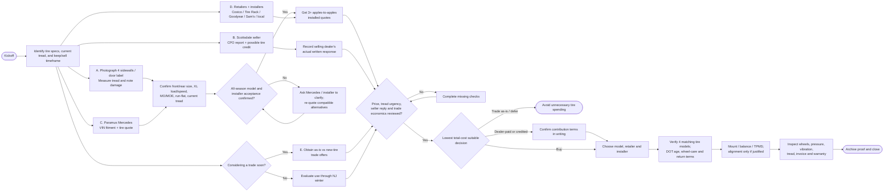

# CLE tire research — sequential and parallel execution

The diagram renders visually on GitHub. **Columns branching after kickoff are independent outreach lanes**; arrows merging at gates show required dependencies. No purchase or installation is authorized by this plan.

## Phase 0 — Evidence, before purchasing (start now)

- Photograph **left-front, right-front, left-rear, right-rear** tire markings; inspect the door-jamb placard. Confirm sizes against VIN-specific Mercedes guidance. Document current manufacturer/model, MO/MOE, XL, run-flat and DOT code.
- Measure inner/center/outer tread at all four corners; retain the **minimum** for each. Prior information around **5/32 inch** is not a fresh documented reading.
- Record signs of damage, uneven wear, vibration, bulges, cracks and whether the vehicle will actually be kept through this winter.
- If significant damage or unsafe wear is evident, arrange an inspection before using the vehicle; do not delay necessary maintenance solely for deal-hunting.

## Phase 1 — **Launch these independent lanes in parallel**

### Lane B — Mercedes-Benz North Scottsdale (selling dealer)
Request: signed CPO inspection and each tire's tread measurements at certification/delivery, tire age/model, tire/wheel protection purchased, and applicable 2026 CPO minimum criteria. Ask for **goodwill, credit, or reimbursement** toward replacement given purchase on Sep 13, 2026. *A request is not a guarantee of coverage.* Save written outcome.

### Lane C — Mercedes-Benz of Paramus (servicing dealer)
Ask service advisor/tire desk for VIN-specific tire specs, an approved all-season list (MO, MOE, run-flat, standard tire questions), wheel/TPMS requirements, all-in parts/labor quote, and whether replacing 2 versus all 4 is acceptable given verified tread differences on 4MATIC. Ask if current wear pattern suggests alignment/suspension inspection.

### Lane D1 — Retailers
At the same time request **two 245/35ZR20 fronts + two 275/30ZR20 rears** of each same model **pending size verification**:
- Tire Rack (plus installer quote)
- Costco Tire Center (Bayonne or another nearby warehouse)
- Goodyear and local branded dealers
- Sam's Club tire center if sizes/membership fit
- Optional independent retailer that can supply/install, e.g. a Tire Rack listed installer

Record SKU, date, stock, installation date, mount/balance, TPMS, disposal, tax, shipping, mandatory fees, promos, and road-hazard and return terms.

### Lane D2 — Installers
Ask explicitly whether they will install customer-supplied **20-inch low-profile staggered** tires, whether they protect AMG wheel rims, what happens in a wheel-damage claim, and price for mount/balance, road-force balancing (optional), valves/TPMS, disposal and tax. Compare against a one-shop supply-plus-install quote.

### Lane E — Buy versus trade economics (if trade is plausible)
Collect written **as-is** and **with four new compatible tires** offers from the same trade buyer under the same terms. A new tire set does not necessarily add its purchase price to the offer.

## Phase 2 — Reconcile evidence and shortlist (sequential gate)

1. **Fitment gate:** Confirm exact sizes, correct load/speed indices, compatible tire construction, run-flat implications, and Mercedes/installer approval. Rear **275/30R20** must not be mistaken for **275/35R20**.
2. **Price gate:** Obtain **at least three written, comparable total installed quotes**. If Costco lacks one of the staggered sizes, remove it from final choice, but retain as benchmark if helpful.
3. **Policy gate:** Check actual treadwear warranty treatment for staggered fitment, road hazard deductibles/proration, and whether *mounted/used* tires are refundable/exchangeable. A generic 30-day return window might cover unused tires only.
4. **Dealer assistance gate:** Record what Scottsdale will actually pay, if anything, and whether an authorized vendor is required.
5. **Keep/trade gate:** Weigh near-term ownership timeline and actual trade-in uplift attributable to replacement, not hypothetical resale recovery.

## Phase 3 — Purchase only if justified

- Confirm inventory and DOT manufacture age, model consistency, accepted fitment, final all-in price and rebates.
- Photograph 20-inch AMG rims before installation; choose equipment appropriate for low-profile tires. Verify installed tread direction, correct pressure/TPMS function and balancing; alignment is conditional on wear/handling findings.
- Photograph rim condition after work; road-test for vibration; keep invoice, DOT details and warranties.

## Branch triggers

| Trigger | Follow-up |
|---|---|
| Mercedes insists on MO/MOE or run-flat | Ask for VIN-specific written requirement and requote compatible SKUs |
| Tire Rack has cheap tires but costly installer | Compare final *installed* number with dealer/warehouse quotes |
| Costco cannot source both staggered sizes | Switch to another supplier |
| Warranty advertised at 45k/50k | Get actual staggered application; do not assume full mileage |
| Selling dealer offers credit | Get terms in writing before ordering |
| Trade-in offer barely increases with new tires | Usually preserve cash if selling promptly and current tires are serviceable |
| Cracking, bulging or unsafe wear | Prioritize professional inspection |
